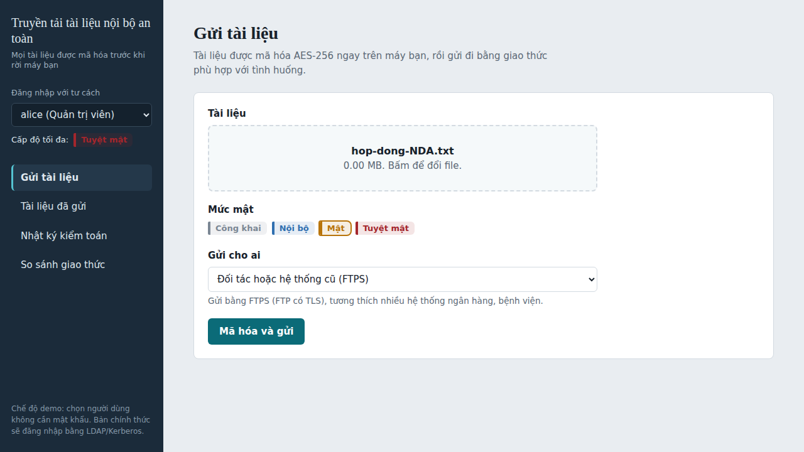
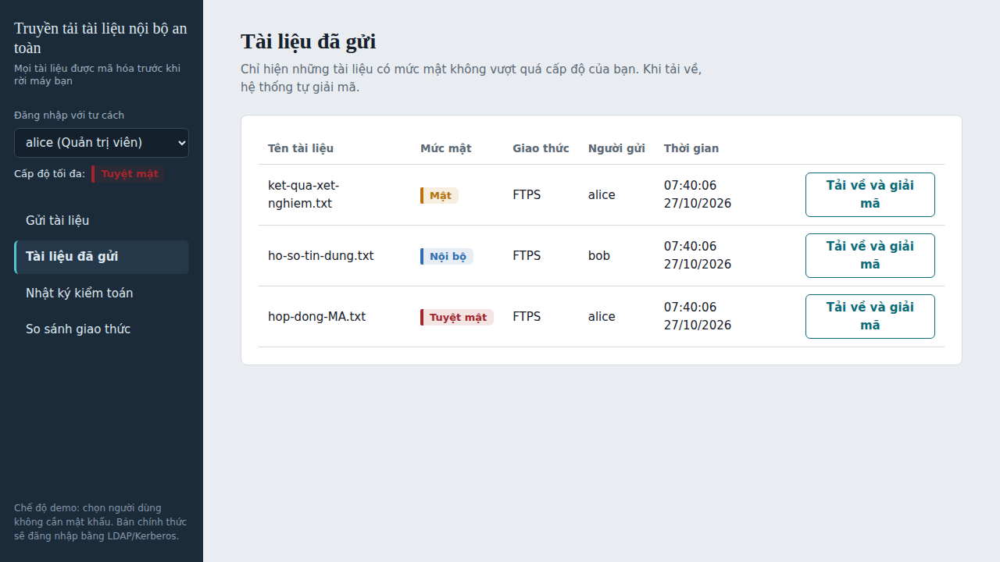
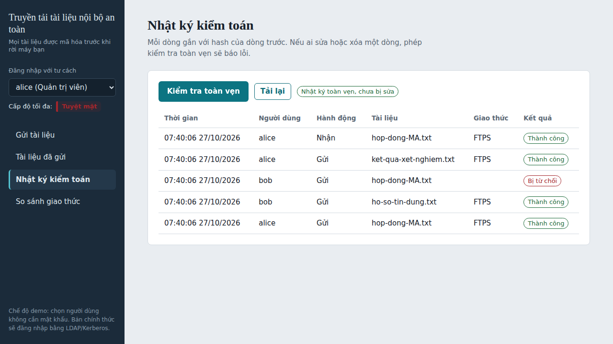

# Hệ thống Truyền tải Tài liệu Nội bộ An toàn (Secure Internal Document Transfer)

> Bài tập nhóm – Môn Mạng máy tính / Giao thức mạng (nhóm 3 SV)
> **Nhóm giao thức đề xuất (ngoài danh sách 20 giao thức):** Truyền tệp bảo mật – **FTPS, SCP, rsync**. Dùng **SFTP** làm mốc so sánh. Hỗ trợ thêm **Syslog** (gửi nhật ký kiểm toán, tùy chọn). **LDAP/Kerberos** nằm trong kế hoạch nhưng **chưa làm** (xem mục 3).

## Thành viên

| STT | Họ và tên | MSSV | Vai trò |
|-----|-----------|------|---------|
| 1 | Ngô Tùng Anh Tú | _..._ | Nhóm trưởng | 
| 2 | Dương Trần Bảo Linh | _..._ | Thành viên |
| 3 | Nguyễn Huỳnh Bảo Hoàng | _..._ | Thành viên | 

## Tình trạng hiện tại

**Đã chạy được và có test tự động (128 test, chạy bằng `python -m pytest -q`):**
- Gửi và nhận tài liệu qua **FTPS, SCP, rsync, SFTP** bằng một gateway duy nhất, chọn giao thức theo tình huống.
- Tài liệu được mã hóa **AES-256-GCM** trước khi gửi tới máy chủ lưu trữ, nên máy chủ lưu trữ chỉ thấy bản mã hóa.
- Đăng nhập bằng mật khẩu (băm scrypt) và token JWT; phân quyền theo 3 vai trò và 4 mức mật.
- Nhật ký kiểm toán chống sửa (hash-chain, có thể bật chữ ký HMAC), link chia sẻ có thời hạn, giao diện web, công cụ so sánh giao thức.

**Chưa làm:** đăng nhập một lần bằng LDAP/Kerberos, quy trình phê duyệt hai người, xuất báo cáo tuân thủ, số đo thật trong tài liệu so sánh giao thức, đóng gói ứng dụng bằng Docker, tự động chạy test trên GitHub.

---

## 1. Định hướng làm đề tài

### 1.1. Bài toán
Các tổ chức xử lý dữ liệu nhạy cảm vẫn thường chia sẻ tài liệu nội bộ qua email, USB, Zalo/Messenger hoặc FTP không mã hóa. Cách này dễ gây **rò rỉ dữ liệu, không kiểm soát được ai đã truy cập, không có bằng chứng truy vết** khi xảy ra sự cố.

### 1.2. Mục tiêu
Xây dựng ứng dụng **truyền tải tài liệu nội bộ an toàn**, trong đó:
- Hỗ trợ **nhiều giao thức truyền tệp bảo mật (FTPS, SCP, rsync)** và chọn giao thức phù hợp theo từng tình huống sử dụng.
- Mọi thao tác (gửi, tải, chia sẻ, đăng nhập) đều được **xác thực, phân quyền và ghi nhật ký kiểm toán**.
- Dữ liệu được bảo vệ trên đường truyền (TLS hoặc SSH) **và** được mã hóa AES-256-GCM tại gateway trước khi lưu, nên máy chủ lưu trữ không đọc được nội dung.
- Có chức năng **so sánh hiệu năng** giữa các giao thức (kèm SFTP làm mốc) để giúp tổ chức lựa chọn.
- Dễ triển khai on-premise trong mạng nội bộ.

### 1.3. Thị trường & tệp khách hàng hướng tới
Ứng dụng được thiết kế linh hoạt để phục vụ các tổ chức có yêu cầu bảo mật dữ liệu ở mức cao nhất:

| Lĩnh vực | Nhu cầu chính | Tài liệu cần bảo vệ |
|----------|---------------|---------------------|
| **Ngân hàng & Tài chính** | Chống rò rỉ, tuân thủ chuẩn an toàn thông tin **PCI DSS** | Hồ sơ tín dụng, báo cáo giao dịch mật |
| **Y tế & Bệnh viện lớn** | Bảo vệ quyền riêng tư bệnh nhân | Hồ sơ bệnh án điện tử, kết quả xét nghiệm |
| **Văn phòng Luật sư & Kiểm toán** | Bảo mật thông tin khách hàng, có bằng chứng truy vết | Hợp đồng M&A, sổ sách kế toán, thỏa thuận NDA |

### 1.4. Giao thức sử dụng trong đề tài

**Nhóm giao thức chính – Truyền tệp bảo mật (nhóm tự đề xuất):**

| Giao thức | Làm gì | Tầng OSI | Tình huống sử dụng trong hệ thống |
|-----------|--------|----------|-----------------------------------|
| **FTPS** (FTP over TLS) | Truyền tệp, kênh điều khiển và kênh dữ liệu mã hóa bằng TLS | L7 (TLS ở L5-L6), chạy trên TCP (L4) | Trao đổi với đối tác hoặc hệ thống cũ (ngân hàng, bệnh viện) vẫn dùng FTP |
| **SCP** | Sao chép tệp qua SSH | L7, chạy trên TCP (L4) | Quản trị viên chuyển nhanh từng tệp giữa các máy chủ |
| **rsync** | Đồng bộ tệp, chỉ gửi phần thay đổi | L7, chạy qua SSH/TCP (L4) | Đồng bộ và sao lưu tài liệu giữa các chi nhánh |

**Giao thức đối chiếu (có trong danh sách 20 giao thức):** **SFTP** dùng làm mốc so sánh hiệu năng và bảo mật với FTPS, SCP, rsync.

**Giao thức hỗ trợ:**

| Giao thức | Vai trò | Tình trạng |
|-----------|---------|-----------|
| **Syslog** | Gửi nhật ký kiểm toán tới máy chủ log tập trung | Có sẵn, bật bằng `ST_SYSLOG_HOST`; chưa thử với máy chủ rsyslog thật |
| **LDAP/LDAPS** | Thư mục người dùng, phòng ban | Dự kiến, **chưa làm** |
| **Kerberos** | Xác thực bằng vé (ticket), đăng nhập một lần (SSO) | Dự kiến, **chưa làm** |

### 1.5. Kiến trúc tổng quan

```
 Trình duyệt ──(nên đặt sau HTTPS khi triển khai thật)──> API (FastAPI)
                    đăng nhập scrypt + JWT · phân quyền theo vai trò và mức mật
                    nhật ký kiểm toán (hash-chain, HMAC tùy chọn)
                                        │
                                        ▼
                        Gateway: mã hóa AES-256-GCM theo khối
                                        │  chọn giao thức theo tình huống
                  ┌─────────────┬───────┴──────┬─────────────┐
                  ▼             ▼              ▼             ▼
                FTPS           SCP           rsync         SFTP
                  │             └──────── SSH ─┴─────────────┘   (mốc so sánh)
                  ▼                          ▼
           Máy chủ FTPS                 Máy chủ SSH
                  └────── chỉ lưu các file .enc (bản mã hóa) ──────┘
```

---

## 2. Các project tham khảo + Link GitHub

Các link dưới đây đã được kiểm tra còn truy cập được vào ngày 01/11/2026.

| # | Giao thức | Project | Link GitHub | Dùng để tham khảo |
|---|-----------|---------|-------------|-------------------|
| 1 | FTPS | fclairamb/ftpserverlib | https://github.com/fclairamb/ftpserverlib | Thư viện FTP server (Go) có hỗ trợ TLS/FTPS |
| 2 | FTPS | goftp/server | https://github.com/goftp/server | Xây FTP server tùy biến, cấu hình TLS |
| 3 | SCP / SSH | OpenSSH Portable | https://github.com/openssh/openssh-portable | Cài đặt chuẩn của SSH và scp |
| 4 | SCP | bramvdbogaerde/go-scp | https://github.com/bramvdbogaerde/go-scp | Thư viện SCP client bằng Go |
| 5 | rsync | RsyncProject/rsync | https://github.com/RsyncProject/rsync | Cài đặt chính thức của rsync, thuật toán delta |
| 6 | Syslog | rsyslog/rsyslog | https://github.com/rsyslog/rsyslog | Gom và chuyển tiếp log tập trung |
| 7 | LDAP | go-ldap/ldap | https://github.com/go-ldap/ldap | Thư viện LDAP client bằng Go |
| 8 | Kerberos | jcmturner/gokrb5 | https://github.com/jcmturner/gokrb5 | Thư viện Kerberos bằng Go |
| 9 | SFTP (mốc so sánh) | pkg/sftp | https://github.com/pkg/sftp | Thư viện SFTP, dùng đo so sánh |

---

## 3. Nhóm làm thêm / phát triển thêm những gì mà các project tham khảo chưa có

Các project trên mỗi cái chỉ giải quyết **một giao thức hoặc một khâu riêng lẻ**: chúng lo việc *truyền*, hoặc *xác thực*, hoặc *ghi log*, nhưng **chưa có hệ thống gắn kết tất cả thành giải pháp hoàn chỉnh cho nghiệp vụ bảo mật của tổ chức**. Nhóm bổ sung các phần sau:

| # | Tính năng nhóm phát triển thêm | Các project tham khảo còn thiếu gì? | Tình trạng |
|---|--------------------------------|--------------------------------------|-----------|
| 1 | **Gateway hợp nhất FTPS + SCP + rsync** (kèm SFTP làm mốc), tự chọn giao thức theo tình huống | Mỗi project chỉ hỗ trợ một giao thức, người dùng phải tự cấu hình riêng | **Đã làm**, đã thử với máy chủ FTPS giả lập và OpenSSH thật |
| 2 | **Công cụ so sánh giao thức**: nhiều cỡ file, lặp nhiều lần, xuất CSV, biểu đồ trên web | Không có | **Một phần**: công cụ đã xong, nhưng bảng số đo thật trong `docs/SO_SANH_GIAO_THUC.md` chưa được điền |
| 3 | **Mã hóa AES-256-GCM theo khối** trước khi gửi tới máy chủ lưu trữ, phát hiện file bị sửa hoặc cắt cụt | Các giao thức chỉ bảo vệ trên đường truyền; file nằm trên máy chủ ở dạng rõ | **Đã làm**. Mã hóa diễn ra tại gateway, không phải trong trình duyệt (xem mục 6) |
| 4 | **Phân quyền theo vai trò (admin, staff, auditor)** và 4 mức mật (Công khai, Nội bộ, Mật, Tuyệt mật) | Chỉ có quyền file/thư mục cơ bản | **Đã làm**. Đồng bộ người dùng từ LDAP: **chưa làm** |
| 5 | **Đăng nhập một lần (SSO) bằng Kerberos** | Thường chỉ có tên và mật khẩu | **Chưa làm** |
| 6 | **Nhật ký kiểm toán chống sửa**: hash-chain, chữ ký HMAC (đặt `ST_AUDIT_KEY`), file `.head` phát hiện xóa dòng cuối, nút kiểm tra toàn vẹn | Log rời rạc theo từng dịch vụ, có thể bị sửa | **Đã làm**. Gửi tập trung qua Syslog: có sẵn tùy chọn, chưa thử với rsyslog thật |
| 7 | **Link chia sẻ có thời hạn**: tối đa 7 ngày, giới hạn số lần tải (tối đa 100), thu hồi được, không cho chia sẻ tài liệu mức Tuyệt mật | Không có | **Đã làm** |
| 8 | **Quy trình phê duyệt hai người** trước khi chia sẻ tài liệu tuyệt mật ra ngoài | Không có | **Chưa làm** |
| 9 | **Giao diện web** (đăng nhập, gửi, tải, chia sẻ, nhật ký, so sánh giao thức) và **báo cáo tuân thủ** | Hầu hết chỉ dùng dòng lệnh hoặc file cấu hình | Giao diện: **đã làm**. Xuất báo cáo tuân thủ ra file: **chưa làm** |

**Các phần làm thêm ngoài kế hoạch ban đầu:**
- Đăng nhập bằng mật khẩu băm scrypt (tối thiểu 12 ký tự) và token JWT hết hạn sau 60 phút; mọi lần đăng nhập, kể cả thất bại, đều ghi vào nhật ký.
- Chặn gửi đè tài liệu trùng tên và chặn hạ mức mật khi ghi đè; link chia sẻ gắn với một phiên bản tài liệu nên hết hiệu lực khi tài liệu bị thay.
- Kết nối SSH an toàn hơn: chế độ `strict host key` (chỉ tin máy chủ đã được xác nhận, chặn khi khóa máy chủ đổi), lệnh `trust-host` và lệnh chẩn đoán `ssh-check`.
- Giới hạn dung lượng upload 50 MB, thông báo lỗi tiếng Việt, 128 test tự động.

---

## 4. Giao diện

| Gửi tài liệu | Tài liệu đã gửi | Nhật ký kiểm toán |
|:---:|:---:|:---:|
|  |  |  |


## 5. Cài đặt & chạy thử

**Yêu cầu:** Python 3.12 (đã kiểm thử) và Git. Tùy chọn: Docker Desktop để chạy máy chủ SSH; trên Windows cần WSL2 nếu muốn thử rsync.

```bash
git clone https://github.com/mlor707/nh-m-10-ltm.git
cd nh-m-10-ltm
python -m venv .venv
.venv\Scripts\activate          # macOS/Linux: source .venv/bin/activate
pip install -r requirements.txt
copy .env.example .env          # macOS/Linux: cp .env.example .env
python -m pytest -q             # test SSH tự bỏ qua nếu máy không có sshd
```

**Chạy giao diện web** (dùng máy chủ FTPS giả lập, không cần Docker):

1. Mở `.env`, đặt `ST_JWT_SECRET` là một chuỗi ngẫu nhiên dài ít nhất 32 byte. Tạo bằng:
   `python -c "import secrets; print(secrets.token_urlsafe(48))"`
   Nên đặt thêm `ST_AUDIT_KEY` (cùng cách tạo) để nhật ký kiểm toán được ký HMAC.
2. Đặt mật khẩu cho tài khoản demo (mỗi lệnh hỏi mật khẩu hai lần, tối thiểu 12 ký tự):
   ```bash
   python -m securetransfer.auth set-password alice
   python -m securetransfer.auth set-password bob
   python -m securetransfer.auth set-password carol
   ```
3. Mở hai cửa sổ terminal:
   ```bash
   # Cửa sổ 1: máy chủ FTPS giả lập
   python -m securetransfer.devserver

   # Cửa sổ 2: ứng dụng
   uvicorn securetransfer.api:app --reload
   ```
4. Mở http://127.0.0.1:8000 và đăng nhập. `alice` là admin, `bob` là nhân viên (mức Nội bộ), `carol` là kiểm toán viên.

**Thử SCP, SFTP, rsync** cần một máy chủ SSH:

```bash
python -m securetransfer.devssh keygen        # tạo khóa đăng nhập, in ra các dòng cần thêm vào .env
docker compose up -d --build                  # bật máy chủ SSH (chỉ máy chủ SSH, chưa gồm ứng dụng)
python -m securetransfer.cli ssh-check        # chẩn đoán từng bước, mỗi lỗi kèm gợi ý
python -m securetransfer.cli benchmark --sizes 1 10 50 --repeat 3 --csv data/benchmark.csv
```
Chi tiết và cách xử lý lỗi: [docs/DUNG_SSH_DEV.md](docs/DUNG_SSH_DEV.md).

## 6. Giới hạn đã biết

- **Không phải mã hóa đầu-cuối từ trình duyệt.** Trình duyệt gửi tài liệu tới API, và gateway mã hóa rồi mới gửi tới máy chủ lưu trữ. Máy chủ lưu trữ (FTPS, SSH) chỉ thấy bản mã hóa, nhưng máy chạy gateway giữ khóa `data/master.key` và thấy nội dung gốc.
- **API chạy HTTP thường.** Khi triển khai thật phải đặt sau một proxy HTTPS (ví dụ nginx), nếu không mật khẩu và token đi qua mạng ở dạng rõ.
- **Cấu hình mặc định chỉ để phát triển:** tài khoản FTPS `test/test123`, chứng chỉ tự ký với `ST_FTPS_VERIFY=false`, và kết nối SSH tự tin cậy máy chủ lạ ở lần đầu (bật `ST_SSH_STRICT_HOST_KEY=true` khi demo hoặc chạy thật). Không dùng nguyên cấu hình này để chạy thật.
- **Khóa mã hóa và nhật ký lưu trên cùng máy chạy ứng dụng.** Nhật ký chống sửa tốt hơn khi đặt `ST_AUDIT_KEY`, nhưng người có cả khóa lẫn quyền ghi file vẫn có thể làm giả.
- **Số đo tốc độ chỉ có ý nghĩa tương đối.** Máy chủ FTPS thử nghiệm viết bằng Python, còn SSH dùng OpenSSH; xem phần "Giới hạn của phép đo" trong [docs/SO_SANH_GIAO_THUC.md](docs/SO_SANH_GIAO_THUC.md).
- Trên Windows, rsync chỉ chạy được trong WSL2.


## 7. Tài liệu trong repo

| File | Nội dung |
|------|----------|
| [docs/HUONG_DAN_DEV.md](docs/HUONG_DAN_DEV.md) | Hướng dẫn phát triển, cấu trúc code |
| [docs/DUNG_SSH_DEV.md](docs/DUNG_SSH_DEV.md) | Dựng máy chủ SSH, chế độ strict host key, xử lý lỗi |
| [docs/SO_SANH_GIAO_THUC.md](docs/SO_SANH_GIAO_THUC.md) | So sánh FTPS, SCP, rsync, SFTP và cách đo |

## 8. Giấy phép

MIT, xem file [LICENSE](LICENSE).
